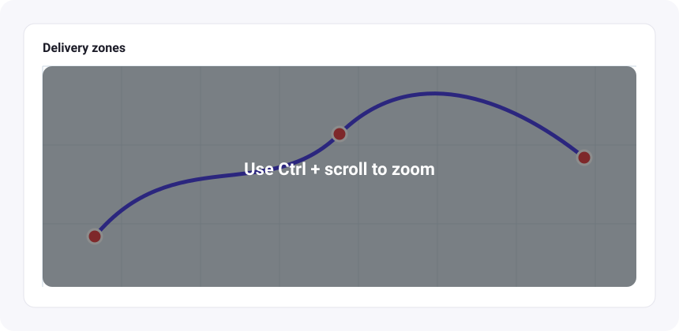

# ctrl_scroll_zoom_guard

[](https://pub.dev/packages/ctrl_scroll_zoom_guard)
[](https://github.com/senkop/ctrl_scroll_zoom_guard/actions/workflows/ci.yml)
[](LICENSE)

Stop maps, charts and zoomable widgets from hijacking the mouse wheel on Flutter web and desktop. A plain scroll scrolls the page; **Ctrl + scroll** (⌘ + scroll on macOS) zooms the map, like Google Maps embeds do.

- Wrap any Flutter-drawn zoomable widget: `InteractiveViewer`, `flutter_map`, charts
- Plain scrolls go to the page, so users never get stuck inside a map
- A "Use Ctrl + scroll to zoom" hint fades in over the child
- macOS shows ⌘ instead of Ctrl
- Custom hint widget and duration



## Install

```bash
flutter pub add ctrl_scroll_zoom_guard
```

## Usage

```dart
import 'package:ctrl_scroll_zoom_guard/ctrl_scroll_zoom_guard.dart';

ScrollZoomGuard(
  child: InteractiveViewer(
    maxScale: 5,
    child: myMap,
  ),
)
```

## Options

| Parameter | Default | Description |
| --- | --- | --- |
| `enabled` | `true` | Turn the guard on or off |
| `message` | `'Use Ctrl + scroll to zoom'` | Hint on Windows and Linux |
| `macMessage` | `'Use ⌘ + scroll to zoom'` | Hint on macOS |
| `hintDuration` | 1.5 s | How long the hint stays |
| `scrollParent` | `true` | Pass blocked scrolls to the page |
| `hintBuilder` | `null` | Custom hint widget |

> Platform views (like the native Google Maps view on web) receive browser events directly. For those, use the map's own cooperative gesture option.

## Example

```bash
cd example
flutter create .
flutter run -d chrome
```

## License

MIT
